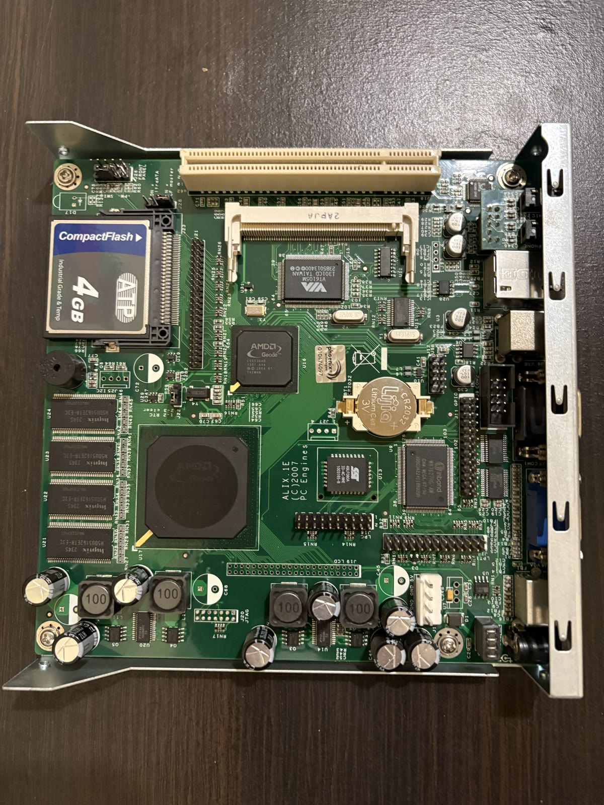
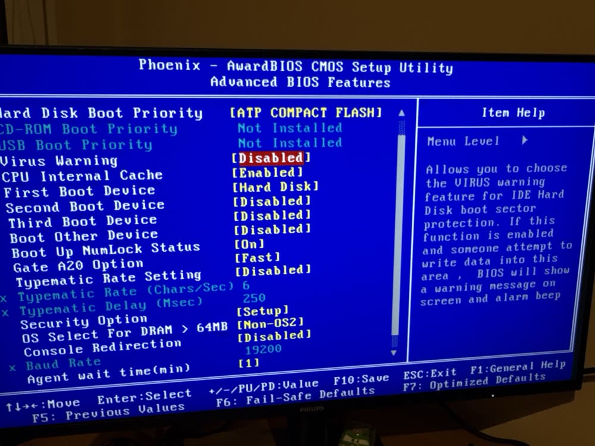

# Stary komputer przemysłowy jako brama VPN

Kolega ma w domu starego Synology. Dwa dyski, zdjęcia z kilkunastu lat, system,
który ostatnią aktualizację dostał dawno temu. Chciał mieć do niego dostęp spoza
domu. Najprostsza odpowiedź, czyli „wystaw NAS-a do internetu”, odpadała
od razu: niełatany NAS w internecie to kwestia czasu, a nie pytanie „czy”.

Router kolegi nie ma serwera VPN. Budżet projektu: zero złotych.

Za to w szufladzie leżało to:



PC Engines ALIX.1E. Projekt z 2007 roku, procesor AMD Geode LX800 o zawrotnej
częstotliwości 500 MHz, 256 MB RAM-u i karta CompactFlash 4 GB zamiast dysku.
Komputer przemysłowy wycofany z eksploatacji, który miał iść na złom. Trafił
do mnie z nieznanym systemem i bez hasła. Ja nie miałem ani czytnika kart CF,
ani kabla szeregowego. Poprzedni system został w całości nadpisany, a w tym
repozytorium nie ma nic z jego zawartości.

Ten README opisuje, jak z tego zrobiłem bramę WireGuard, która ma stanąć u kolegi,
aktualizować się sama i nie wymagać, żeby ktokolwiek się nią zajmował.

---

## Komputer, który udawał, że się wyłącza

Pierwsze uruchomienie: logi Debiana, DHCP, start usług... i czarny ekran.
Wyglądało to tak, jakby komputer się wyłączał. Klawiatura nie reagowała,
dioda na porcie sieciowym świeciła.

Klatka po klatce z nagrania telefonem wyszło coś innego. Ostatnie linie przed
wygaśnięciem ekranu to `Starting OpenBSD Secure Shell server: sshd`, a potem
`Last login: ... on tty1`. System działał. Miał autologin i aplikację, która
po starcie przejmowała konsolę i ją wygaszała.

Skoro działa SSH, wystarczy znaleźć urządzenie w sieci. Jest tylko jeden haczyk:
stary `dhclient` pyta o adres raz, przy starcie. Wpięcie kabla po uruchomieniu
nic nie daje. Kabel do routera, restart, `nmap -sn` i jest: host z MAC-iem
od „PC Engines GmbH”.

```
$ ssh root@192.168.1.150
Received disconnect from 192.168.1.150 port 22:2: Too many authentication failures
```

Serwer rozłączał, zanim w ogóle zapytał o hasło. Mój klient SSH grzecznie
przedstawiał po kolei wszystkie klucze z `~/.ssh` i agenta, a każdy liczył się
jako nieudana próba. `-o PubkeyAuthentication=no` załatwia sprawę. Tyle że
hasła i tak nie znałem.

## Hasło i klawiatura, która znikała

Plan klasyczny: GRUB, `e`, na koniec linii `linux` dopisać `init=/bin/bash`,
`passwd`, gotowe.

Pierwsza przeszkoda: menu GRUB-a pojawiało się na dwie sekundy i strzałki nie
działały. Klawiatura na bezprzewodowym donglu nie dogadywała się z BIOS-em
z 2010 roku. Przewodowa zadziałała od razu.

Druga przeszkoda była ciekawsza. `init=/bin/bash` dał mi shell roota:

```
bash: cannot set terminal process group (-1): Inappropriate ioctl for device
bash: no job control in this shell
root@(none):/# _
```

...i w tym momencie klawiatura przestała działać. Kursor mrugał, ale nic nie
dało się wpisać.

Wyjaśnienie: w GRUB-ie klawiaturą USB zajmuje się BIOS. Po starcie jądra robi
to już Linux, a dokładniej moduł `usbhid`, który normalnie ładuje udev.
Przy `init=/bin/bash` udev nie startuje, więc nie ma `usbhid` i nie ma
klawiatury.

Rozwiązanie: zamiast `init=/bin/bash` dopisać `break=bottom`. Initramfs Debiana
zatrzymuje się wtedy w swoim shellu ratunkowym, który sam ładuje sterowniki
klawiatury, a główny system plików jest już zamontowany w `/root`:

```sh
mount -o remount,rw /root
chroot /root passwd root
sync
```

Wyłączenie zasilania, ponowny start, SSH z nowym hasłem. Jestem w środku.

## Nadpisać dysk, z którego się działa

Teraz pytanie, co na tym w ogóle uruchomić. Geode LX to specyficzny procesor:
32 bity, bez SSE2 i bez instrukcji NOPL. To od razu wyklucza obecnego Alpine'a
(wymaga SSE2) i aktualne 32-bitowe Debiany (budowane pod i686 z NOPL). Gentoo
z `-march=geode` by poszło, ale kompilacja na 500 MHz trwałaby dni.

Został OpenWrt, który ma osobny target `x86/geode`, budowany dokładnie pod ten
procesor. Do tego squashfs z nakładką (mało zapisów na kartę CF), WireGuard
w jądrze i panel WWW, w którym kolega sam doda nowy telefon.

Zostało go wgrać. Bez czytnika CF jedyna droga prowadziła przez działający
system. Czyli: nadpisać kartę, z której ten system właśnie chodzi.

Brzmi źle, ale ma sens. Skompresowany obraz OpenWrt ma 9 MB, więc mieści się
w RAM-ie (`/run/shm` to tmpfs). Przed zapisem przełączam wszystkie systemy
plików w tryb tylko do odczytu przez SysRq, żeby stary Debian niczego nie
dopisał w trakcie. `zcat` i `dd` są już w pamięci, więc dokończą robotę, nawet
gdy dysk pod nimi zmieni zawartość.

```sh
echo u > /proc/sysrq-trigger; \
zcat /run/shm/openwrt-25.12.6-x86-geode-generic-squashfs-combined.img.gz | dd of=/dev/sda bs=1M; \
sync; echo b > /proc/sysrq-trigger
```

```
126353408 bytes (126 MB) copied, 6.33112 s, 20.0 MB/s
-bash: sync: command not found
```

Za `dd` dobrze. `sync` gorzej: leżał na karcie, którą właśnie nadpisałem.
Restart i tak się wykonał (`echo` to builtin powłoki), OpenWrt wstał, ale bez
`sync` nie miałem pewności, że wszystko dotarło na kartę. Dlatego od razu
zrobiłem drugi, porządny zapis już z poziomu OpenWrt przez `sysupgrade`.
Następnym razem skopiuję `sync` do tmpfs przed zapisem.

<details>
<summary>Pełna procedura wgrywania</summary>

```sh
# laptop: obraz i weryfikacja
wget https://downloads.openwrt.org/releases/25.12.6/targets/x86/geode/openwrt-25.12.6-x86-geode-generic-squashfs-combined.img.gz
wget https://downloads.openwrt.org/releases/25.12.6/targets/x86/geode/sha256sums
sha256sum -c sha256sums --ignore-missing
scp -O openwrt-*.img.gz root@IP:/dev/shm/

# stary Debian: upewnić się, że to ten dysk
cat /proc/partitions            # sda = 3 923 640 KiB, jedyny dysk
gzip -t /dev/shm/openwrt-*.gz

# zapis (komenda wyżej)

# OpenWrt wstaje jako 192.168.1.1 z własnym DHCP, więc kablem prosto do laptopa
cat openwrt-*.img.gz | ssh root@192.168.1.1 "cat > /tmp/fw.img.gz"
ssh root@192.168.1.1
sha256sum /tmp/fw.img.gz
sysupgrade -T /tmp/fw.img.gz
sysupgrade -n /tmp/fw.img.gz
```

Wariant BIOS (nie `-efi`) i squashfs (nie ext4), żeby mieć overlay i reset
do ustawień fabrycznych. Karta po instalacji: 16 MB `/boot`, ~104 MB squashfs
z overlayem, reszta wolna.

</details>

## VPN na jednej nodze

ALIX ma jeden port Ethernet. Nie stanie więc między routerem a siecią, tylko
obok, jako zwykłe urządzenie w LAN-ie. Ruch z tunelu wchodzi i wychodzi tym
samym kablem:

```
telefon (LTE, hotel, ...)
    |  WireGuard, UDP 51820
    v
router  --- przekierowanie UDP 51820 --->  ALIX
    |                                       wg0: 10.10.10.1/24
    +-- NAS                                 lan: adres z DHCP routera
    +-- TV
```

Jest z tym jeden problem. Telefon w tunelu ma adres 10.10.10.2. NAS dostaje
od niego zapytanie, chce odpowiedzieć, nie zna takiej sieci, więc wysyła
odpowiedź do bramy domyślnej, czyli routera. Router też jej nie zna i pakiet
ginie. W firmowej sieci dodałbym trasę statyczną, ale domowy router tego
nie potrafi.

Rozwiązaniem jest NAT na samym ALIX-ie (masquerading na strefie `lan`).
NAS widzi zapytanie od ALIX-a, odpowiada ALIX-owi, a ALIX przekazuje
odpowiedź do telefonu. Router i NAS nie muszą nic wiedzieć o VPN-ie.

Klienci mają pełny tunel (`AllowedIPs = 0.0.0.0/0, ::/0`), więc w hotelowym
Wi-Fi cały ruch idzie przez dom. `::/0` jest po to, żeby IPv6 z sieci
komórkowej nie omijało tunelu. Z internetu widać tylko UDP 51820. Panel
i SSH odpowiadają wyłącznie z LAN-u i z VPN-u.

### Pułapka, w którą wpadłem

Pierwszy telefon nie chciał się połączyć. Powód: w ustawieniach peera po
stronie ALIX-a wpisałem `0.0.0.0/0`, bo przecież „chcę full tunnel”.

W WireGuardzie `AllowedIPs` znaczą co innego po każdej stronie:

```
peer na ALIX-ie:     10.10.10.2/32     = kim jest to urządzenie
konfiguracja telefonu: 0.0.0.0/0, ::/0  = co puszczać tunelem
```

Po stronie serwera to pole działa jednocześnie jako filtr adresów źródłowych
i tablica routingu. Przy drugim urządzeniu z `0.0.0.0/0` serwer nie wiedziałby,
komu odesłać pakiet. `0.0.0.0/0` należy tylko do konfiguracji klienta.

<details>
<summary>Konfiguracja OpenWrt, WireGuarda i firewalla</summary>

OpenWrt jako zwykły klient sieci (bez DHCP i ogłoszeń IPv6):

```sh
uci set system.@system[0].hostname='alix-vpn'
uci set system.@system[0].zonename='Europe/Warsaw'
uci set system.@system[0].timezone='CET-1CEST,M3.5.0,M10.5.0/3'
uci set network.lan.proto='dhcp'
uci delete network.lan.ipaddr
uci delete network.lan.netmask
uci set dhcp.lan.ignore='1'
uci set dhcp.lan.ra='disabled'
uci set dhcp.lan.dhcpv6='disabled'
uci commit
/etc/init.d/odhcpd disable
```

Pakiety (od 25.12 menedżerem jest `apk`, nie `opkg`):

```sh
apk add luci-proto-wireguard qrencode luci-app-ddns ddns-scripts-services owut \
        luci-i18n-base-pl luci-i18n-firewall-pl luci-i18n-ddns-pl
/etc/init.d/rpcd restart; /etc/init.d/network restart   # inaczej LuCI nie widzi WireGuarda
```

Interfejs `wg0`: `10.10.10.1/24`, `listen_port 51820`. Peery:
`allowed_ips 10.10.10.X/32`, preshared key. Klient: `AllowedIPs = 0.0.0.0/0, ::/0`,
`DNS = IP_ALIX`, `PersistentKeepalive = 25`.

Firewall:

```sh
uci add firewall zone
uci set firewall.@zone[-1].name='vpn'
uci set firewall.@zone[-1].input='ACCEPT'
uci set firewall.@zone[-1].output='ACCEPT'
uci set firewall.@zone[-1].forward='REJECT'
uci add_list firewall.@zone[-1].network='wg0'
uci add firewall forwarding
uci set firewall.@forwarding[-1].src='vpn'
uci set firewall.@forwarding[-1].dest='lan'
uci set firewall.@zone[0].masq='1'          # zone[0] = lan
uci commit; /etc/init.d/firewall restart
```

</details>

## System, który ma sobie radzić beze mnie

Tu zaczęła się najtrudniejsza część, bo nie techniczna. Po oddaniu ALIX-a
nie będę miał do niego dostępu, a kolega nie jest informatykiem. Urządzenie
stoi między internetem a siecią, w której jest dziurawy NAS. Bez aktualizacji
z każdym miesiącem robi się coraz mniej bezpieczne.

Na OpenWrt nie robi się `apk upgrade` całego systemu, bo moduły jądra muszą
pasować do jądra z obrazu. Aktualizacja to nowy obraz i `sysupgrade`. Tyle że
zwykły obraz z serwera nie ma WireGuarda, więc po takiej aktualizacji VPN
po prostu by zniknął.

Z pomocą przychodzi `owut`. Zamawia na serwerze ASU OpenWrt obraz zbudowany
z dokładnie tymi pakietami, które są zainstalowane na urządzeniu, pobiera go,
sprawdza i instaluje z zachowaniem konfiguracji. `owut check -v` potwierdził,
że serwer obsługuje `x86/geode`.

Był jeszcze jeden haczyk, wyczytany z `--help`: `owut upgrade` bez `-V`
przebudowuje wersję, która już jest zainstalowana. Z 25.12.6 na 25.12.7 sam
nie przejdzie. Dlatego skrypt sam sprawdza, jakie jest najnowsze wydanie
w gałęzi:

```sh
PATCH=$(wget -qO- https://downloads.openwrt.org/.versions.json \
  | jsonfilter -e '@.versions_list[*]' \
  | grep "^$BRANCH\.[0-9][0-9]*$" | sed "s/^$BRANCH\.//" | sort -n | tail -n1)
...
owut upgrade -V "$BRANCH.$PATCH" </dev/null 2>&1 | logger -t auto-upgrade
```

Cron odpala go w każdą niedzielę o 4:17. Na nową gałąź (np. 26.x) nie
przechodzi, bo tam zmiany bywają duże i to już zadanie dla człowieka.
Na wszelki wypadek `rc.local` dwie minuty po starcie sprawdza, czy jest
WireGuard, i w razie czego go doinstalowuje.

Pełne pliki: [`auto-upgrade`](files/usr/bin/auto-upgrade),
[`rc.local`](files/etc/rc.local),
[`sysupgrade.conf.append`](files/etc/sysupgrade.conf.append).

### Czy to w ogóle działa?

Nie chciałem się dowiedzieć dopiero u kolegi. Wymusiłem pełną aktualizację tak,
jak zrobiłby to cron, czyli bez terminala:

```sh
owut upgrade --force </dev/null
```

`owut` o nic nie zapytał, zbudował obraz, zainstalował go i zrestartował
ALIX-a. Że to faktycznie nowy obraz, widać po dacie kompilacji BusyBoxa
w banerze SSH: było `2026-10-17 21:45`, jest `2026-10-18 00:11`. Po restarcie:

```
# wg show                 -> wg0 na porcie 51820, peery na miejscu
# cat /etc/crontabs/root  -> 17 4 * * 0 /usr/bin/auto-upgrade
# apk info -e kmod-wireguard luci-proto-wireguard qrencode owut
kmod-wireguard
luci-proto-wireguard
qrencode
owut
# logread -e rc.local     -> pusto, awaryjna doinstalacja nie była potrzebna
```

Hasło, konfiguracja, cron i skrypty przetrwały.

## BIOS i jedna ciekawostka

Ostatnia rzecz przed oddaniem: BIOS. ALIX.1E ma pełny Phoenix AwardBIOS
z obsługą VGA. Dwie zmiany pod pracę bez nadzoru:

- **Halt On: No Errors.** Bateria CR2032 na płycie ma swoje lata. Gdy padnie,
  BIOS zgłosi błąd sumy CMOS i stanie na „Press F1”, czego u kolegi nikt nie zobaczy.
- **Start tylko z karty CF.** USB, „Removable” i „Boot Other Device” wyłączone.

Opcji „włącz po zaniku prądu” nie ma, ale nie jest potrzebna. Płyta nie ma
przycisku zasilania i startuje od razu po podaniu napięcia.



A ciekawostka siedzi w pierwszej linijce: **Virus Warning**. To relikt
z czasów DOS-a i wirusów sektora rozruchowego, takich jak Stoned czy
Michelangelo. Po włączeniu BIOS przechwytuje zapisy do MBR wykonywane przez
przerwanie INT 13h i ostrzega piskiem. Tyle że Linux ma własny sterownik IDE
i z INT 13h w ogóle nie korzysta, więc ta „ochrona” nie zobaczyłaby niczego.
Zostaje wyłączona.

## Czego to nie załatwia

Auto-aktualizacje to kompromis. Bez nich system z czasem zbiera niezałatane
dziury. Z nimi zawsze jest szansa, że któraś aktualizacja się nie uda i VPN
przestanie działać, dopóki ktoś nie podejdzie do urządzenia. Uznałem,
że niedziałający VPN to niewygoda, a włamanie do sieci z NAS-em to szkoda.

Pozostałe ograniczenia, o których wiem:

- gałąź 25.12 ma skończone wsparcie, potem potrzebna jest ręczna migracja albo wyłączenie VPN-a
- OpenWrt może kiedyś porzucić target geode (w maju 2026 na liście deweloperów była [dyskusja](https://lists.openwrt.org/pipermail/openwrt-devel/2026-May/044808.html) o porządkowaniu 32-bitowych targetów)
- nie ma zdalnej konsoli, więc nieudany flash oznacza wizytę na miejscu
- sprzęt jest stary: kondensatory, karta CF, bateria CR2032
- router kolegi też jest wystawiony do internetu i jego aktualizacje są poza moim zasięgiem

Kolega ma w [instrukcji](docs/instrukcja-uzytkownika.md) prostą zasadę: gdy coś
przestanie działać albo VPN nie będzie już potrzebny, wystarczy wyjąć wtyczkę
i usunąć przekierowanie portu w routerze. Wyłączone urządzenie jest zawsze
bezpieczne.

<details>
<summary>Specyfikacja sprzętu</summary>

| Układ | Oznaczenie |
|---|---|
| CPU | AMD Geode LX800, 500 MHz, bez SSE2 i NOPL |
| Mostek | AMD Geode CS5536AD |
| RAM | 4× Hynix H5DU5162ETR DDR, razem 256 MB, wlutowane |
| Ethernet | VIA VT6105M, 10/100 Mbit |
| Super I/O | Winbond W83627HG (COM, GPIO, watchdog) |
| BIOS | Phoenix AwardBIOS `07/19/2010-AMD-LX800-6A43AEM1C-00`, flash SST 49LF080A |
| Dysk | ATP CompactFlash 4 GB, industrial grade |

</details>

## Pliki w repozytorium

```
README.md
docs/instrukcja-uzytkownika.md     instrukcja dla kolegi
docs/img/                          zdjęcia
files/usr/bin/auto-upgrade         skrypt aktualizacji
files/etc/rc.local                 awaryjna doinstalacja WireGuarda
files/etc/sysupgrade.conf.append   pliki zachowywane przy aktualizacji
```

## Źródła

- [OpenWrt 25.12.6, x86/geode](https://downloads.openwrt.org/releases/25.12.6/targets/x86/geode/)
- [owut](https://github.com/efahl/owut)
- [OpenWrt: z opkg na apk](https://openwrt.org/docs/guide-user/additional-software/opkg-to-apk-cheatsheet)
- [Alpine Linux: wymagania sprzętowe](https://wiki.alpinelinux.org/wiki/Requirements)
